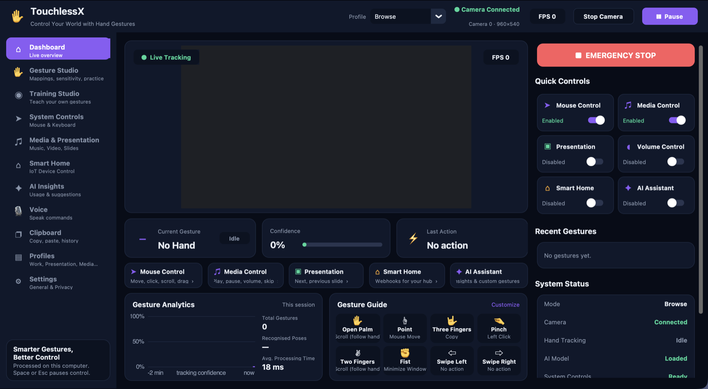
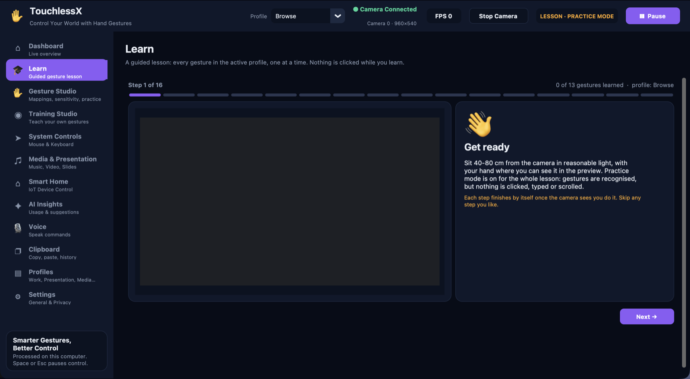
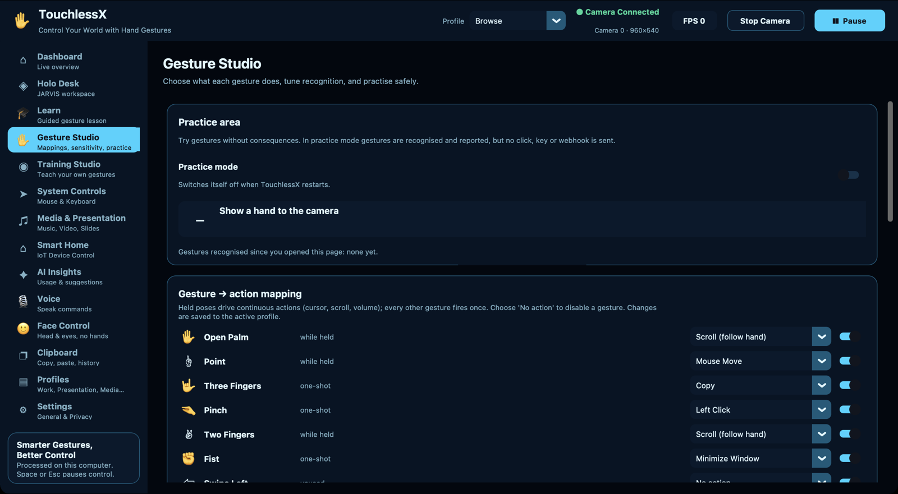
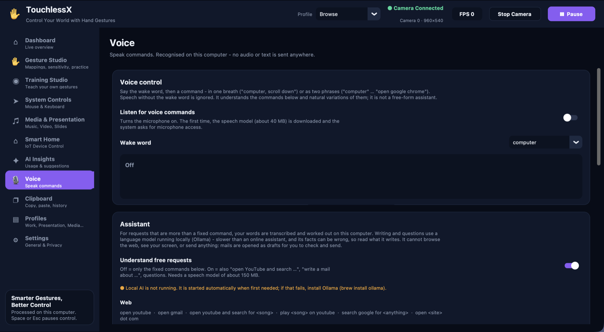
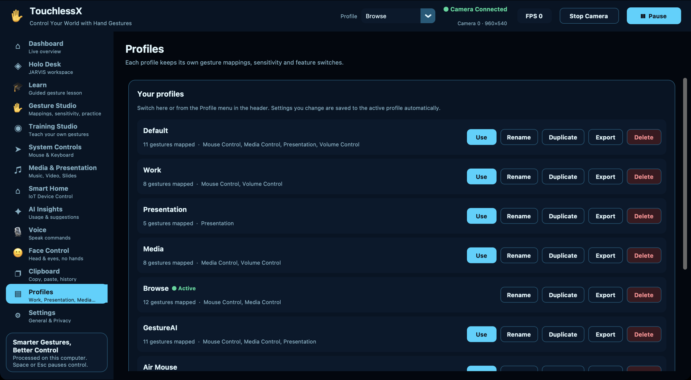
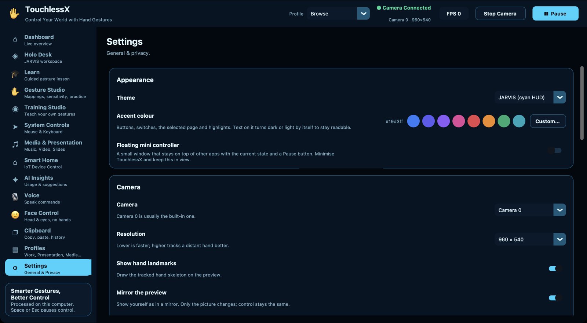

# TouchlessX

A Python desktop app that turns your webcam into a touchless controller: it tracks
your hand, recognizes a small set of deliberate gestures, and maps them to mouse
movement, clicks, scrolling, media control, and presentation navigation. Everything
runs locally — no cloud account, no video stored or uploaded.

## Screenshots



**New here?** Open **Learn** in the sidebar: a guided lesson that teaches every gesture in your
profile, one at a time, with the camera checking each one. Nothing is clicked while you learn.



| Gesture Studio | Voice |
|---|---|
|  |  |
| **Profiles** | **Settings** |
|  |  |

## Gesture map (Default profile)

| Gesture | Action | Category |
|---|---|---|
| ✋ Open Palm | Move the cursor (steered by the palm) | Mouse Control |
| 🤏 Pinch (thumb + index) | Left click; twice quickly = double-click; hold to drag (optional) | Mouse Control |
| ✌️ Two Fingers (index + middle) | Right click | Mouse Control |
| 🤟 Three Fingers, move up/down | Scroll | Mouse Control |
| ☝️ Point, move up/down | Volume up/down | Volume Control |
| ✊ Fist | Play / Pause media | Media Control |
| 👈 👉 Fast flick left / right | Previous / next slide | Presentation |
| 👍 Thumbs Up | Confirm a pending smart-home command | — |
| 👆 👇 Fast flick up / down | Not mapped by default | — |
| 🖐 Opening the hand out of a fist | Not mapped by default (Restore Window in Browse) | — |
| 🤏🤏 Two-hand pinch, move hands apart / together | Zoom in / out (⌘ + / ⌘ −; Ctrl on Windows) | — |
| 🙌 Both palms open, held | Pause / resume control | — |

The **Air Mouse** profile makes one hand a complete mouse: the open hand (or a
pointing finger) moves the cursor, pinch is the left button (once = click, twice =
double-click, held = drag and drop), two fingers right-click, three fingers scroll in
both directions, and a fist is a rest pose that does nothing.

The **Browse** profile turns the open hand into a two-way scroller (move it up/down or
left/right), makes a fist minimise the front window and opening the hand restore it,
and moves the cursor with a pointing finger instead.

Every mapping can be changed, or disabled, in **Gesture Studio**, and each **profile**
(Default, Work, Presentation, Air Mouse, Browse, GestureAI, Media, or your own) keeps its own set.

What keeps it from misfiring:

- A hand shape only counts once it has been seen for consecutive frames, so the shapes
  a hand passes through while opening or closing do nothing.
- One-shot poses (fist, two fingers, thumbs-up) must be held briefly; scroll and volume
  start after a short hold. Pinch, the click, acts at once.
- A pinch releases only when the fingers open clearly (hysteresis), so it cannot flicker.
- The cursor follows the palm through a speed-adaptive filter: steady when the hand
  rests, immediate when it moves.
- Only fast flicks count as swipes; ordinary cursor movement does not.
- Scrolling is by swipe: a quick flick of the hand sets the page rolling and it coasts
  to a stop; slow movement, and the hand coming back for the next flick, do nothing.
  Scrolling carries on through frames where a fast hand blurs and the pose is lost.
  "Glide" (distance from a neutral point sets the speed) and "Follow" are alternatives.
  Output is in pixels, not whole lines, so it moves smoothly.
- Detections under the confidence threshold are ignored.
- A **resting hand is ignored**: when the wrist is at the bottom edge of the picture or
  below it (a hand on the desk or keyboard, half out of view) nothing is recognised.
  Raise the hand so the wrist is visible to use gestures. This and the two rules below
  came from replaying recorded real use, where a resting hand read as a fist had
  minimised a window 27 times in three minutes.
- A thumb-and-index touch is only a pinch when the hand is otherwise open or the index
  finger reaches forward; in a closed fist the thumb rests on the index finger too, and
  that used to click.
- One fist minimises one window: a second minimise within two seconds is ignored.

The **GestureAI** profile is a lock-based layout: the open palm is a neutral "safe"
pose, a pointing finger steers the cursor, pinch clicks and drags, two fingers scroll,
a sideways-pointing finger changes slides, a **fist locks** all gesture control and a
**thumbs-up unlocks** it. While locked, hand movement does nothing.

**Stopping control:** the red **EMERGENCY STOP** button on the dashboard, **Space** or
**Esc** (while TouchlessX is in front), the **Pause** button, or Pause on the
**floating mini controller** that stays above other apps. None of these depend on a
gesture being recognised. You can also choose one **emergency stop gesture** in
Settings that works in every profile, even while locked. **Stop Camera** turns tracking off entirely. **Practice mode** (Gesture Studio)
recognises gestures without sending anything.

Everything that is implemented, in one document:
[docs/PROJECT_DOCUMENTATION.md](docs/PROJECT_DOCUMENTATION.md).
Full instructions for users: [docs/USER_GUIDE.md](docs/USER_GUIDE.md).

## Setup

Requires Python 3.10–3.12 with Tk (MediaPipe publishes no wheels for the newest
Python releases, and Homebrew's `python3` ships without Tk).

```bash
cd TouchlessX
python3.12 -m venv .venv
source .venv/bin/activate        # Windows: .venv\Scripts\activate
pip install -r requirements.txt
python app.py
```

With [uv](https://docs.astral.sh/uv/), which also fetches a suitable Python for you:

```bash
uv venv --python 3.12 .venv
uv pip install --python .venv/bin/python -r requirements.txt
.venv/bin/python app.py
```

The first start downloads MediaPipe's hand-landmark model (~8 MB) into
`assets/models/`. That is the only download; camera frames never leave the machine.

`python app.py --check` runs a headless self-test: it loads the model, opens the camera,
tracks for a few seconds and prints the measured frame rate. It sends no input.

### Permissions

- **Camera** — the OS asks on first start. On macOS the permission belongs to the app
  you launch from (Terminal, VS Code, …). TouchlessX retries automatically once you
  answer the prompt.
- **Input control (macOS)** — System Settings → Privacy & Security → Accessibility →
  enable the app you launch from, then restart TouchlessX. Until then the dashboard
  shows *System Controls: No permission* and gestures are detected but control nothing.
  The **System Controls** page shows the status and can open the request prompt.
- **Windows**: no extra permission needed, but antivirus/UAC may prompt once.
- **Linux**: `pyautogui` needs an X11 session (not plain Wayland) for mouse control.

## The app

| Page | What it does |
|---|---|
| **Dashboard** | Live preview with landmarks, current gesture / confidence / last action, on-off switches per category, recent actions, session analytics, gesture guide, system status. |
| **Learn** | A guided lesson built from the active profile: one step per gesture (plus double-click), each finished when the camera sees it done, with a live preview. Practice mode is on while the page is open. |
| **Gesture Studio** | Practice area (nothing is sent), gesture → action mapping with an on/off switch per gesture, per-gesture confidence and cooldown, recognition sensitivity, reset. |
| **Training Studio** | Record examples of your own poses, train a scikit-learn classifier, see accuracy / precision / recall and the confusion matrix, keep and revert model versions. Gesture control is off while this page is open. |
| **System Controls** | Cursor speed, smoothing, dead zone, double-click window, scroll speed, drag, user-defined keyboard shortcuts, applications to open, pointer calibration, input-permission status. |
| **Media & Presentation** | Media / volume / slide switches, arrow vs. Page Up/Down slide keys, test buttons, compatibility notes. |
| **Smart Home** | Optional. Webhooks from a hub (Home Assistant, Node-RED, IFTTT, …) mapped to gestures, with thumbs-up confirmation. Off by default. |
| **AI Insights** | Usage from the local history, recognition quality, rule-based suggestions, clear-history, model training history. |
| **Voice** | Optional spoken commands after a wake word ("computer, scroll down slowly", "computer, change the tab", "computer, open google chrome"). Recognised offline on this computer. |
| **Clipboard** | Which gesture does copy / cut / paste / delete / select all / undo / redo, and an in-memory history of the last ten copied texts that can be put back or pasted by gesture. |
| **Profiles** | Create, rename, duplicate, switch, import and export profiles. |
| **Settings** | Dark / light theme, accent colour (eight presets or any colour you pick), mini controller, camera and resolution, mirror preview, controlling hand (left / right / either), emergency stop gesture, privacy and data retention, setup guide, versions. |

Settings are saved to `config/settings.json`. Profiles (`config/profiles.json`),
smart-home devices (`config/smart_home.json`, may hold tokens), the training dataset
(`data/gesture_samples.csv`), trained models (`data/models/`) and the action history
(`data/history.db`) are git-ignored.

Keyboard shortcuts are built from an approved key list (modifiers plus one key), and
"open application" actions accept only an application bundle or executable you picked,
started without arguments. A gesture can never run a command or script. Imported
profiles are validated, and cannot bring shortcuts, applications or smart-home targets
with them.

### Voice commands

Speech is recognised on this computer by [Vosk](https://alphacephei.com/vosk/) with a
small English model (about 40 MB, downloaded once when voice is first switched on); no
audio or text is sent anywhere. Only phrases that start with the wake word count.
Recognition is limited to the words commands are made of plus the names of installed
applications, and the parser maps what it hears onto the app's existing actions:
scrolling (one push, "a little", "fast", "slowly" / "keep" until "stop"), tabs,
switching and opening applications, clicks, copy / paste / undo, media, slides, and
stop / resume. It is a command set with natural variations, not a free-form assistant,
and it cannot run command lines or open files. Voice obeys the emergency stop, the
feature switches and Practice mode like gestures do, and works with the camera off.

Checked against synthesized speech in a US and an Indian English voice (61 of 62
commands understood); a real microphone in a real room will do worse, and that has not
been measured.

### Assistant (free requests)

With **Understand free requests** on (Voice page), a phrase addressed to the app that
is more than a fixed command is transcribed by an open-vocabulary recogniser (Whisper
"base", about 150 MB, on this computer) and worked out:

- "open YouTube and search for <song>", "play <song> on YouTube", "open Gmail",
  "search Google for <anything>", "open <site> dot com" open the right address in your
  browser. Web sites need not be installed; an installed application of the same name
  is preferred.
- "type <words>" pastes exactly what you said where the cursor is.
- "write a mail about <topic>" (optionally "to <person>"), "write a paragraph about
  ...", and questions go to a language model running locally through
  [Ollama](https://ollama.com) (`llama3.2:3b`, about 2 GB). A mail is opened as a
  **draft** in Gmail or your mail app for you to check and send; other writing is
  pasted at the cursor; answers are shown and read aloud.

Set-up for the AI part: `brew install ollama`, then `ollama pull llama3.2:3b`. The app
starts the Ollama service itself when it is first needed.

What it is not: it cannot browse the web, see the screen, click through a site for
you, or send anything by itself, and a small local model writes plainly and can get
facts wrong. Speech without the wake word is never transcribed. The language model
only ever returns text; nothing it writes is executed.

Checked with synthesized speech (14 of 14 free requests turned into the right kind of
task, in two voices); song titles and other unusual names are often misspelt by the
recogniser, and real-room accuracy has not been measured.

### Custom gestures

MediaPipe finds the hand; the Training Studio only teaches a small classifier to name
a *pose* from the 21 landmarks. Samples are stored as normalised landmark features in
`data/gesture_samples.csv` (a header, then `label, f0 … f41` per sample) - never images
or video. Training uses k-nearest-neighbours from scikit-learn, holds back 25% of the
samples for evaluation, and warns about thin or unbalanced data. Because a classifier
always answers with one of its labels, a pose only counts if it is also geometrically
close to that gesture's samples; anything else is ignored. Custom gestures are
consulted only for poses the built-in rules do not already recognise. The reported
figures describe your dataset, not every lighting, camera or user.

### Privacy

- Frames are processed in memory and discarded; nothing is recorded or uploaded.
- No telemetry, no account.
- The action history (`data/history.db`) and diagnostic log (`logs/actions.log`) hold
  only time, gesture, action and confidence. Both can be switched off and cleared in
  **Settings**; history is pruned after the retention period you choose.
- Custom gestures store landmark coordinates, never images.
- The diagnostic log also keeps `logs/frames.csv`: the hand's 21 landmark points and
  how each recent frame was classified (a few minutes, size-capped). It is what makes
  it possible to tune recognition on real use instead of guesses. Same switch, same
  Clear button; coordinates only.
- Clipboard history is held in memory only and is never written to disk. It contains
  whatever text you copy, passwords included, so it has its own off switch.
- Voice control is off until you switch it on. While it is on the microphone is open
  and the header shows it; audio is processed in memory on this computer and discarded.
- With "Check for updates at start" on (the default), the app asks GitHub once per
  start whether a newer release exists. Switch it off under Settings.
- Network use is otherwise limited to the one-time model downloads (hand tracking, and speech if
  you use voice) and the smart-home webhooks you configure yourself.

## Project structure

```
TouchlessX/
├── app.py                   # Entry point (+ --check self-test)
├── pyproject.toml / requirements.txt
├── config/
│   └── settings.json        # Your settings, created on first run (git-ignored, like all personal data)
├── docs/
│   ├── USER_GUIDE.md
│   └── QA_CHECKLIST.md       # Manual tests the automated suite cannot cover
├── src/
│   ├── config.py             # Defaults + tolerant load/save of settings.json
│   ├── camera.py             # Camera Layer - reads webcam frames
│   ├── hand_tracker.py       # Hand Tracking Layer - MediaPipe Hand Landmarker
│   ├── gesture_engine.py     # Classification, debouncing, hold-to-fire, swipes
│   ├── custom_gestures.py    # Landmark features + the distance check for trained poses
│   ├── training.py           # Dataset (CSV), scikit-learn training, evaluation, model versions
│   ├── tutorial.py           # The guided lesson on the Learn page: steps and progress
│   ├── action_controller.py  # Gesture -> action dispatch, cursor filter, shortcuts, OS input
│   ├── safety.py             # Pause / emergency stop, lock, confidence gating
│   ├── profiles.py           # Profile store, presets, import validation
│   ├── history.py            # SQLite action history
│   ├── smart_home.py         # Optional webhooks
│   ├── voice.py              # Offline speech recognition, wake word, command parser
│   ├── assistant.py          # Free requests: web, dictation, mail and answers via a local AI
│   ├── clipboard.py          # In-memory clipboard history
│   ├── colors.py             # Accent colour arithmetic
│   ├── system.py             # Data folder, start at login, update check, menu-bar icon
│   ├── action_log.py         # Text log + session statistics / suggestions
│   ├── ui.py                 # App shell, dashboard, mini controller, pipeline thread
│   ├── ui_pages.py           # The other pages
│   └── ui_widgets.py         # Light/dark palette and widget helpers
└── tests/                    # 252 tests; no camera, display, network or real input needed
```

## Running the tests

The gesture, mapping, profile, shortcut, history, custom-gesture and webhook logic runs
with no camera, display, network or real mouse/keyboard:

```bash
pip install pytest
pytest tests/ -v
```

## Compatibility

| | Tested |
|---|---|
| OS | macOS on Apple Silicon |
| Python | 3.12 |
| Libraries | MediaPipe 0.10.21, OpenCV 4.11, CustomTkinter 5.2.2, PyAutoGUI 0.9.54, NumPy 1.26, scikit-learn 1.9, Tk 9.0 |

Windows and Linux use the same code paths apart from media keys and are expected to
work, but have not been tested.

MediaPipe is pinned to 0.10.21 or older on purpose. Newer builds (seen with 0.10.35)
bundle a usage-statistics uploader that periodically tries to contact Google, which
would contradict the "nothing leaves this computer" promise above. The pinned build
does not contain it.

## Known limitations

- Built-in gestures are geometry-based and tuned for a hand facing the camera in
  reasonable lighting. No accuracy or latency figure is published: none has been
  measured across users, lighting and hardware (see docs/QA_CHECKLIST.md).
- One user at a time. Two hands are used only for the two-hand pinch (zoom) and
  both palms (pause); every other gesture is one-handed.
- There is no system-wide pause hotkey: Space and Esc work only while TouchlessX is the
  front window. The floating mini controller covers pausing from other apps.
- Custom gestures are only consulted for poses the built-in rules don't recognise, and
  are matched in 2D.
- "Either hand" follows whichever hand the tracker reports first; choose a controlling
  hand in Settings if a second hand in view causes jumps.
- Opening applications works on macOS and Windows only. Windows support as a whole is
  written but untested.
- Smart Home sends a plain HTTP POST per trigger; it has no device discovery or state.
- The macOS app built by `scripts/build_macos.sh` is not code-signed, so macOS warns the
  first time it opens. There is no Windows build, and the menu-bar icon is macOS only.
- The update check only reports a new version; it does not install it.
- Not for vehicle, medical, industrial or other safety-critical control.

## Not implemented from the product scope

- Distribution: code signing and notarisation, automatic update installation, a
  Windows installer, licence activation, editions.
- Cloud services: accounts, sync, remote AI.
- A system-wide pause hotkey and a Windows tray icon.
- Application-aware profile switching.
- From the GestureAI specification: the PySide6 interface and its folder layout (this
  app stays on CustomTkinter with the modules above), Matplotlib charts, cursor
  acceleration, optional video recording, and running user-defined commands (left out
  on purpose - gestures may press keys and open chosen applications, nothing more).
- Separate Windows and Linux adapters with their own testing.
