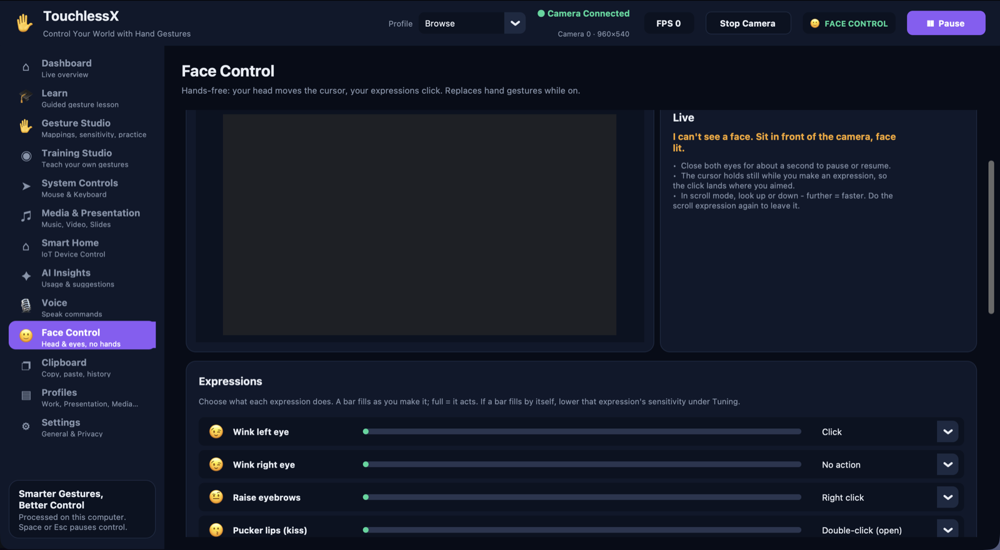

# TouchlessX

**Control your computer without touching it.** TouchlessX turns an ordinary webcam
into a touchless controller: move the cursor, click, scroll, zoom, play music and run
presentations with **hand gestures**, with your **face** (head movement and
expressions), or by **voice**. Everything runs on your own computer — no account, no
cloud, and no video is ever stored or uploaded.

## Highlights

- ✋ **Hand gestures**: cursor, click, double-click, drag, right-click, scroll, zoom,
  volume, media and slides, in several ready-made **profiles**.
- 🙂 **Face Control**: a hands-free mode. Your head moves the cursor; a wink clicks,
  raised eyebrows right-click, puckered lips open things, an open mouth scrolls.
- 🎙 **Voice commands**: "computer, scroll down", "computer, open google chrome".
  Recognised offline. An optional local AI assistant can search, type and draft mails.
- 🎓 **Learn**: a guided lesson that teaches every gesture step by step, checking each
  one with the camera.
- 🧠 **Custom gestures**: record your own hand poses and train a classifier on them.
- 🛑 **Safety first**: emergency stop, pause from anywhere, practice mode, and
  protections against accidental clicks.
- 🔒 **Private**: frames are processed in memory and discarded. No telemetry.

## Screenshots


**New here?** Open **Learn** in the sidebar: a guided lesson that teaches every gesture
in your profile, one at a time, with the camera checking each one. Nothing is clicked
while you learn.


**Hands-free?** Turn on **Face Control**: your head moves the cursor and facial
expressions click. Each expression has a live meter, an action you choose and its own
sensitivity.



| Gesture Studio | Voice |
|---|---|
|  |  |
| **Profiles** | **Settings** |
|  |  |

## Quick start

Requires **Python 3.10–3.12 with Tk**. MediaPipe publishes no packages for newer
Python versions, and Homebrew's `python3` comes without Tk.

```bash
cd TouchlessX
python3.12 -m venv .venv
source .venv/bin/activate        # Windows: .venv\Scripts\activate
pip install -r requirements.txt
python app.py
```

Or with [uv](https://docs.astral.sh/uv/), which also fetches a suitable Python:

```bash
uv venv --python 3.12 .venv
uv pip install --python .venv/bin/python -r requirements.txt
.venv/bin/python app.py
```

On first start the **Getting Started** page opens; press **Start the guided lesson**
to learn the gestures. The hand-tracking model (~8 MB) is downloaded once into
`assets/models/`.

`python app.py --check` runs a self-test without a window: it loads the model, opens
the camera, tracks for a few seconds and prints the frame rate. It sends no input.

### Permissions

- **Camera**: the system asks on first start. On macOS the permission belongs to the
  app you launch from (Terminal, VS Code, …). TouchlessX retries by itself once you
  answer.
- **Mouse and keyboard control (macOS)**: System Settings → Privacy & Security →
  Accessibility → enable the app you launch from, then restart TouchlessX. Until then
  gestures are recognised but control nothing, and the dashboard shows
  *System Controls: No permission*.
- **Windows**: no extra permission; antivirus or UAC may ask once.
- **Linux**: mouse control needs an X11 session (not plain Wayland).

### Mac app

`sh scripts/build_macos.sh` builds `dist/TouchlessX.app` and a drag-to-install
`dist/TouchlessX-<version>.dmg` with PyInstaller. The app is signed ad hoc (no paid
Apple certificate), so the first time macOS asks you to confirm: right-click the app,
then **Open**. The packaged app keeps its settings and data in
`~/Library/Application Support/TouchlessX`.

## Hand gestures

### Default profile

| Gesture | Action |
|---|---|
| ✋ Open palm | Move the cursor |
| 🤏 Pinch (thumb + index) | Click · twice quickly = double-click (opens files and folders) · hold = drag (optional) |
| ✌️ Two fingers (index + middle) | Right click |
| 🤟 Three fingers, move up / down | Scroll |
| ☝️ Point, move up / down | Volume up / down |
| ✊ Fist, held | Play / pause media |
| 👈 👉 Fast flick left / right | Previous / next slide |
| 👍 Thumbs up | Confirm a pending smart-home command |
| 🤏🤏 Pinch with both hands, move them apart / together | Zoom in / out (⌘ + / ⌘ −; Ctrl on Windows) |
| 🙌 Both palms open, held | Pause / resume control |
| 👆 👇 Fast flick up / down · 🖐 opening the hand out of a fist | Free to map |

Every gesture can be remapped or switched off in **Gesture Studio**. Besides mouse and
media actions, a gesture can press a keyboard shortcut you define, copy / cut / paste /
undo / redo, switch tabs or apps, go back or forward, zoom, minimise or restore a
window, open a chosen application, or trigger a smart-home webhook.

### Profiles

Each profile keeps its own mappings, sensitivity and feature switches. Switch them
from the header.

| Profile | For |
|---|---|
| **Default** | General use, as in the table above |
| **Air Mouse** | One hand as a complete mouse: move, click, double-click, drag and drop, right-click, scroll both ways; a fist is a rest pose |
| **Browse** | Reading the web: open hand scrolls in any direction, pointing moves the cursor, fist minimises the window and opening the hand restores it |
| **Work** | Mouse and volume only, no media or slide gestures to misfire |
| **Presentation** | Slides only |
| **Media** | Music and video |
| **GestureAI** | Lock-based: open palm is a safe pose, pointing steers, a **fist locks** all control and a **thumbs-up unlocks** it |
| Your own | Create, duplicate, rename, import and export on the **Profiles** page |

### What keeps it from misfiring

- A hand shape counts only after it has been seen for several frames in a row, so the
  shapes a hand passes through while opening or closing do nothing.
- One-shot poses (fist, two fingers, thumbs-up) must be held briefly; scroll and volume
  start after a short hold. Pinch, the click, acts at once.
- A pinch releases only when the fingers clearly open, so it cannot flicker, and a
  thumb resting on the index finger inside a fist is not a pinch.
- The cursor follows the palm through a speed-adaptive filter: steady when the hand
  rests, immediate when it moves.
- Only fast flicks count as swipes; ordinary cursor movement does not.
- A **resting hand is ignored**: with the wrist at the bottom edge of the picture (a
  hand on the desk or keyboard), nothing is recognised.
- Detections below the confidence threshold are ignored, and one fist minimises at
  most one window every two seconds.

Several of these rules came from replaying recorded real use, where a resting hand read
as a fist had minimised a window 27 times in three minutes.

Scrolling has three styles: **Swipe** (a quick flick sets the page rolling and it
coasts to a stop), **Glide** (distance from a neutral point sets the speed) and
**Follow** (the page moves with the hand). Output is in pixels, so it moves smoothly.

## Face Control (hands-free)

Open **Face Control** in the sidebar and switch on **Use Face Control**. The face model
(~4 MB) is downloaded once. While it is on, hand gestures are off so the two never
fight over the cursor; the header shows **🙂 FACE CONTROL**.

| Do this | Default action |
|---|---|
| 🙂 Move your head | Moves the cursor |
| 😉 Wink your left eye | Click · two winks quickly = double-click |
| 🤨 Raise your eyebrows | Right click |
| 😗 Pucker your lips (kiss) | Double-click: open a folder, file or link in one go |
| 😄 Smile | Minimise the window in front |
| 😮 Open your mouth | Scroll mode on / off: look up or down to scroll, further = faster |
| 😌 Close both eyes for about a second | Pause / resume control |

- **Choose your own**: every expression has an action menu (click, double-click, right
  click, scroll mode, minimise window, pause, or nothing), a **live bar** that fills as
  you make it (full = it acts) and its own **sensitivity** slider. The right-eye wink
  is free to map.
- **Precise cursor**: by default the cursor moves like a mouse, with acceleration:
  slow head movements make small, exact moves for tabs and icons, quick ones cross the
  screen. "Point with your head" (where you face is where the cursor goes) is the
  alternative.
- **Clicks land where you aim**: the cursor holds still while an expression is being
  made and until you relax.
- **Ordinary blinks are ignored**: a wink is one eye shut on its own. Each eye is
  measured against its own normal opening, so it adapts to you.

Pause, emergency stop, practice mode and the Mouse Control switch apply to Face Control
exactly as to gestures.

## Voice commands

Switch on **Listen for voice commands** on the **Voice** page. Speech is recognised on
this computer by [Vosk](https://alphacephei.com/vosk/) (a ~40 MB English model,
downloaded once); no audio or text is sent anywhere. Only phrases that start with the
wake word count, for example:

- "computer, scroll down slowly" · "computer, keep scrolling" · "computer, stop"
- "computer, next tab" · "computer, switch app" · "computer, open google chrome"
- "computer, click" · "computer, double click" · "computer, zoom in"
- "computer, copy" · "computer, paste" · "computer, undo"
- "computer, pause music" · "computer, next slide"
- "computer, pause control" (stops all control) · "computer, resume"

It is a command set with natural variations, not a free-form assistant, and it cannot
run command lines or open files. Voice obeys the emergency stop, the feature switches
and practice mode, and works with the camera off. Checked against synthesized speech in
a US and an Indian English voice (61 of 62 commands understood); accuracy with a real
microphone in a real room has not been measured.

### Assistant (free requests)

With **Understand free requests** on, a request that is more than a fixed command is
transcribed by Whisper "base" (~150 MB, on this computer) and worked out:

- "open YouTube and search for *song*", "play *song* on YouTube", "open Gmail",
  "search Google for *anything*", "open *site* dot com" open the right page in your
  browser.
- "type *words*" pastes exactly what you said at the cursor.
- "write a mail about *topic*" (optionally "to *person*"), "write a paragraph about …"
  and questions go to a language model running locally through
  [Ollama](https://ollama.com) (`llama3.2:3b`, ~2 GB). A mail opens as a **draft** for
  you to check and send; other writing is pasted at the cursor; answers are shown and
  read aloud.

Set-up: `brew install ollama`, then `ollama pull llama3.2:3b`. TouchlessX starts the
Ollama service itself when it is first needed.

The assistant cannot browse, see the screen, click through a site or send anything by
itself. A small local model writes plainly and can get facts wrong, and nothing it
writes is ever executed. Checked with synthesized speech (14 of 14 requests turned into
the right kind of task); unusual names such as song titles are often misspelt.

## Learn: the guided lesson

The **Learn** page builds a lesson from the active profile: one step per gesture, plus
double-click. Each step shows the gesture, what to do and what it does, next to a live
camera preview. It completes by itself once the camera sees you do it ("✅ Well done!")
and moves on. Practice mode is on for the whole lesson, so nothing is clicked. You can
skip, go back, or jump to any step; switching profile rebuilds the lesson. A script for
recording a demo video is in [docs/DEMO_VIDEO_SCRIPT.md](docs/DEMO_VIDEO_SCRIPT.md).

## Custom gestures

In the **Training Studio**, record examples of your own hand poses (a rock sign, an
"L" shape, …), train a scikit-learn k-nearest-neighbours classifier and see its
accuracy, precision, recall and confusion matrix. Model versions can be kept and
reverted. Samples are stored as normalised landmark coordinates in
`data/gesture_samples.csv`, never images. A pose counts only if it is also close to that
gesture's samples, and custom gestures are consulted only for poses the built-in rules
don't already recognise. Gesture control is off while the Training Studio is open.

## Safety and stopping

- The red **EMERGENCY STOP** button on the dashboard.
- **Space** or **Esc** while TouchlessX is in front, or the **Pause** button.
- The **floating mini controller**: a small window that stays above other apps with the
  current state and a Pause button.
- An optional **emergency stop gesture** (Settings) that works in every profile, even
  while locked.
- Both palms (hands) or a long blink (Face Control) to pause and resume.
- **Stop Camera** turns tracking off entirely.
- **Practice mode** (Gesture Studio) recognises everything but sends nothing.
- Each feature (mouse, media, presentation, volume, smart home, AI) has its own on/off
  switch on the dashboard.

None of the buttons and keys depend on a gesture being recognised.

## All pages

| Page | What it does |
|---|---|
| **Dashboard** | Live preview with hand landmarks, current gesture, confidence and last action, feature switches, recent gestures, session analytics, gesture guide, system status |
| **Learn** | The guided lesson |
| **Gesture Studio** | Practice area, gesture → action mapping with an on/off switch per gesture, per-gesture confidence and cooldown, recognition sensitivity |
| **Training Studio** | Record, train and evaluate custom gestures; model versions |
| **System Controls** | Cursor speed, smoothing, dead zone, double-click time, scroll style and speed, drag, keyboard shortcuts, applications to open, pointer calibration, permission status |
| **Media & Presentation** | Media, volume and slide switches, arrow vs. Page Up/Down slide keys, test buttons |
| **Smart Home** | Optional webhooks from a hub (Home Assistant, Node-RED, IFTTT, …) mapped to gestures, with thumbs-up confirmation. Off by default |
| **AI Insights** | Usage from the local history, recognition quality, suggestions, training history |
| **Voice** | Voice commands, wake word and the assistant |
| **Face Control** | Hands-free mode: expressions, actions, sensitivity, cursor style |
| **Clipboard** | Gestures for copy / cut / paste / delete / select all / undo / redo, and a history of the last ten copied texts that can be pasted again |
| **Profiles** | Create, rename, duplicate, switch, import and export profiles |
| **Settings** | Dark / light theme, accent colour, mini controller, camera and resolution, mirror preview, controlling hand (left / right / either), emergency stop gesture, start at login, menu-bar icon, update check, privacy and data retention |

### Desktop extras

- **Menu-bar icon** (macOS), and an option to keep running in the menu bar when the
  window is closed.
- **Start at login**: a per-user login entry, no administrator rights needed.
- **Update check**: once per start the app asks GitHub whether a newer release exists
  and shows an **Update** badge. It does not install anything. Can be switched off.

## Privacy

- Camera frames are processed in memory and discarded; nothing is recorded or uploaded.
- No telemetry, no account.
- The action history (`data/history.db`) and diagnostic log (`logs/`) hold only time,
  gesture, action, confidence and hand landmark coordinates — never images. Both can be
  switched off and cleared in **Settings**; history is pruned after the retention
  period you choose.
- Custom gestures store landmark coordinates, never images.
- Clipboard history is kept in memory only, never on disk, and has its own off switch.
- Voice is off until you switch it on; while it is on the header shows it, and audio is
  processed in memory and discarded. Speech without the wake word is never transcribed.
- Network use is limited to the one-time model downloads (hand, face, speech), the
  update check (can be switched off), Ollama on your own computer, and smart-home
  webhooks you configure yourself.

Settings are saved to `config/settings.json`. Profiles, smart-home devices (which may
hold tokens), training data, models and history are kept out of git.

Gestures can press only keys from an approved list and open only applications you
picked, started without arguments. A gesture can never run a command or script.
Imported profiles are validated and cannot bring shortcuts, applications or smart-home
targets with them.

## Project structure

```
TouchlessX/
├── app.py                    # Entry point (+ --check self-test)
├── pyproject.toml, requirements.txt
├── TouchlessX.spec           # PyInstaller recipe for the Mac app
├── scripts/build_macos.sh    # Builds TouchlessX.app and the .dmg
├── docs/
│   ├── USER_GUIDE.md
│   ├── PROJECT_DOCUMENTATION.md
│   ├── QA_CHECKLIST.md       # Manual tests the automated suite cannot cover
│   ├── DEMO_VIDEO_SCRIPT.md
│   └── screenshots/
├── src/
│   ├── camera.py             # Reads webcam frames
│   ├── hand_tracker.py       # MediaPipe hand landmarks
│   ├── gesture_engine.py     # Classification, debouncing, hold-to-fire, swipes, two-hand gestures
│   ├── face_control.py       # Face tracker, head pointer, winks, expressions, scroll mode
│   ├── action_controller.py  # Gesture -> action, cursor filter, shortcuts, OS input
│   ├── safety.py             # Pause, emergency stop, lock, confidence gating
│   ├── custom_gestures.py    # Landmark features and the check for trained poses
│   ├── training.py           # Dataset, scikit-learn training, evaluation, model versions
│   ├── tutorial.py           # The Learn page's lesson steps and progress
│   ├── voice.py              # Offline speech recognition, wake word, command parser
│   ├── assistant.py          # Free requests: web, dictation, mail and answers via a local AI
│   ├── profiles.py           # Profile store, presets, import validation
│   ├── config.py             # Defaults and tolerant loading of settings.json
│   ├── history.py            # SQLite action history
│   ├── action_log.py         # Diagnostic log, session statistics, suggestions
│   ├── clipboard.py          # In-memory clipboard history
│   ├── smart_home.py         # Optional webhooks
│   ├── system.py             # Data folder, start at login, update check, menu-bar icon
│   ├── colors.py             # Accent colour arithmetic
│   ├── ui.py                 # App shell, dashboard, mini controller, camera thread
│   ├── ui_pages.py           # The other pages
│   └── ui_widgets.py         # Light/dark palette and widget helpers
└── tests/                    # 315 tests; no camera, display, network or real input needed
```

## Running the tests

All gesture, face, voice, mapping, profile, shortcut, history, lesson and webhook logic
is tested without a camera, display, network or real mouse and keyboard:

```bash
pip install pytest
pytest tests/ -v
```

## Compatibility

| | Tested |
|---|---|
| OS | macOS on Apple Silicon |
| Python | 3.12 |
| Libraries | MediaPipe 0.10.21, OpenCV 4.11, CustomTkinter 5.2.2, PyAutoGUI 0.9.54, NumPy 1.26, scikit-learn 1.9, Tk 9.0 |

Windows and Linux use the same code apart from media keys and are expected to work,
but have not been tested.

MediaPipe is pinned to 0.10.21 or older on purpose: newer builds (seen with 0.10.35)
include a usage-statistics uploader that tries to contact Google, which would break
the "nothing leaves this computer" promise.

## Known limitations

- Recognition depends on lighting, distance and angle. No accuracy or latency figure is
  published, because none has been measured across users, lighting and hardware (see
  [docs/QA_CHECKLIST.md](docs/QA_CHECKLIST.md)).
- One user at a time. Two hands are used only for zoom and pause.
- Face Control has been tested with synthetic face data; how well each expression works
  differs from face to face, so check the live bars and adjust sensitivity. Glasses
  with reflections and dim light make eye detection less reliable.
- Space and Esc pause only while TouchlessX is the front window; from other apps use
  the mini controller, a gesture or an expression.
- Custom gestures are matched in 2D and only for poses the built-in rules don't
  recognise.
- Opening applications works on macOS and Windows only.
- Smart Home sends a plain HTTP POST per trigger, with no device discovery or state.
- The Mac app is not notarised, so macOS warns the first time. There is no Windows
  build, and the menu-bar icon is macOS only.
- The update check reports a new version; it does not install it.
- Not for vehicle, medical, industrial or other safety-critical control.

## Not implemented yet

- Code signing and notarisation, automatic update installation, a Windows installer,
  licensing.
- Cloud accounts and sync.
- A system-wide pause hotkey and a Windows tray icon.
- Switching profiles automatically by application.
- Running user-defined commands — left out on purpose: gestures may press keys and
  open chosen applications, nothing more.

## Documentation

- [User guide](docs/USER_GUIDE.md): everything a user needs, step by step.
- [Project documentation](docs/PROJECT_DOCUMENTATION.md): everything that is
  implemented, in one document.
- [QA checklist](docs/QA_CHECKLIST.md): the manual tests.
- [Demo video script](docs/DEMO_VIDEO_SCRIPT.md).
